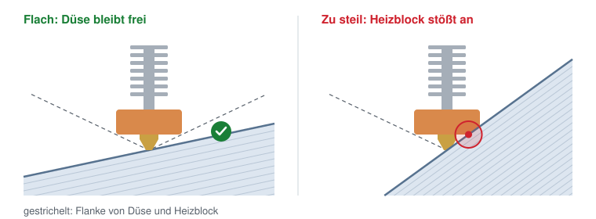

# LSI Lite

Lastoptimiert slicen aus einem FEM-Ergebnis: Aus einer `.vtu`-Datei mit Spannungsfeld
entsteht G-Code für einen 3-Achs-Drucker, dessen Schichten der Zugspannung folgen.
Das Verfahren steht in einer einzigen Python-Datei (`lsi_lite.py`), bedient wird es über
das Notebook `LSI_lite.ipynb`.

**Direkt im Browser starten, ohne Installation:**
<https://colab.research.google.com/github/gereon1112-web/lsi-lite/blob/main/LSI_lite.ipynb>
(oder die Schaltfläche *In Colab öffnen* oben). Nötig ist nur ein Google-Konto.
Lokal läuft dasselbe Notebook in VS Code, siehe [Notebook in VS Code](#notebook-in-vs-code).

LSI Lite ist die verkleinerte Fassung des *Load-Optimized Surface Interpolator* (LSI)
aus der Diplomarbeit von Gereon Zündorf. Das Grundprinzip ist dasselbe, der Umfang
ein Zwanzigstel (siehe [Was vereinfacht ist](#was-vereinfacht-ist)).

## Benutzung im Notebook

Zwei Wege, dasselbe Notebook:

- **Im Browser (Google Colab):** den Link oben öffnen. Die Einstellungen stehen als
  Formular (Auswahllisten, Schieberegler) rechts neben jeder Zelle.
- **Auf dem eigenen Rechner (VS Code):** Ordner klonen und das Notebook darin öffnen,
  siehe [Notebook in VS Code](#notebook-in-vs-code). VS Code zeigt die Colab-Formulare
  nicht an; dieselben Einstellungen stehen dort als Zeilen im Code
  (`duese = 0.4  #@param ...`) und werden direkt dort geändert.

Die Zellen der Reihe nach mit ▶ starten (oder *Alle ausführen*):

1. **Einrichten.** In Colab holt die Zelle die fehlenden Pakete und das Programm von
   GitHub (etwa 30 Sekunden; beim ersten Mal *Trotzdem ausführen* bestätigen). Lokal
   liegt das Programm schon im Ordner; fehlen Pakete, installiert die Zelle sie
   einmalig aus `requirements.txt`.
2. **Eingabe.** Ein Beispiel (Tragwerk, Biegebalken) oder *eigene Datei*: In Colab
   erscheint ein Knopf zum Hochladen, lokal kommt die `.vtu` in den Ordner `eingabe/`.
3. **Einstellungen und Rechnen.** Düse, größte Neigung, Füllung, Drucker, Material,
   Baurichtung (Tabelle unten), dann ▶. Eine Schrittliste zeigt, welcher Schritt gerade
   läuft (bei der Mittelschicht die Stufe, beim Bahnenlegen die Schicht) und wie lange
   jeder erledigte Schritt gedauert hat; darunter steht das Protokoll. Je nach Bauteil
   dauert das 5 Sekunden bis 2 Minuten.
4. **Ansehen.** Alle Bahnen in 3D, mit der Maus drehbar, Farbe = Schicht; schwarze
   Striche = Zugrichtung, länger heißt mehr Zug, ein Klick auf die Legende blendet sie
   aus.
5. **Herunterladen.** In Colab lädt die Zelle den G-Code (`<name>_lite.gcode`) herunter;
   lokal nennt sie den Pfad (neben der `.vtu`, bei den Beispielen in `beispiele/`).

Ändern sich nur Einstellungen, genügt es, ab Zelle 3 neu zu starten.

**Was das Protokoll sagt:**

| Zeile | Bedeutung |
| --- | --- |
| Stufe 1 … 5: Versatz … | wie weit sich die Mittelschicht in jeder Stufe noch ändert |
| Zug in der Schicht 21 % → 78 % | Anteil der Zugspannung, der in der Schicht liegt statt quer durch die Lagenfuge zu ziehen, vor und nach der Optimierung |
| Neigung max | steilste Stelle der Mittelschicht; höchstens die eingestellte Grenze |
| Dicke 0.10 .. 0.29 mm | Schichtdicke senkrecht zur Schicht (5. bis 95. Perzentil) |
| Druckzeit etwa … min | reine Fahrzeit aus Weglänge und Vorschub; ohne Beschleunigung, der Druck dauert real länger |
| ACHTUNG: Schichtdicke … | die Schichten verlassen das Fenster; Neigung senken |
| ACHTUNG: Überhang … | Teile der Schichten hängen in der Luft; andere Baurichtung wählen |

## Einstellungen

| Feld | Bedeutung | Vorgabe |
| --- | --- | --- |
| duese | Düsendurchmesser in mm; legt Schichthöhe und Bahnbreite fest (siehe unten) | 0.4 |
| neigung_max | wie steil eine Schicht stehen darf, in Grad; [warum es eine Grenze gibt](#warum-die-neigung-begrenzt-ist) | 20 |
| fuellung | `konzentrisch` (Ringe parallel zum Rand), `zigzag` (Linien, je Schicht um 90° gedreht) oder `explizit` (Stromlinien entlang der Zugrichtung: beste Ausrichtung, aber Lücken, wo Linien auseinanderlaufen) | konzentrisch |
| fuelldichte | 100 = massiv, 0 = nur Wände | 100 |
| waende | Anzahl Wandbahnen | 1 |
| drucker | legt die Bettgröße fest | 220 x 220 |
| material | Temperaturen, Lüfter, Rückzug | PLA |
| baurichtung | welche Achse des FEM-Modells beim Druck nach oben zeigt; `auto` = bei den Beispielen deren Richtung, sonst +z | auto |

**Schichthöhe und Bahnbreite aus der Düse.** Es gilt die übliche Faustregel: Eine Schicht
ist mindestens 25 % und höchstens 75 % des Düsendurchmessers dick. Darunter fließt das
Material nicht mehr gleichmäßig, darüber drückt die Düse den Strang nicht mehr an.
Die Schichten werden im Mittel 50 % dick. Die Bahn ist so breit wie Düse plus größte
Schichthöhe; so liegt der Strang auch an der dicksten Stelle frei und wird sonst
überall angedrückt (wie im Original).

| Düse | Schicht min … max | im Mittel | Bahnbreite |
| --- | --- | --- | --- |
| 0.4 mm | 0.10 … 0.30 mm | 0.20 mm | 0.70 mm |
| 0.6 mm | 0.15 … 0.45 mm | 0.30 mm | 1.05 mm |

Weitere feste Werte (Geschwindigkeiten, Rückzug, Start-G-Code, Stufen der Mittelschicht)
stehen oben in `lsi_lite.py`.

### Warum die Neigung begrenzt ist

Ein 3-Achs-Drucker hält die Düse immer senkrecht. Ihre Spitze ragt nur wenige Millimeter
unter dem Heizblock hervor. Steigt eine Schicht flach an, bleibt neben der Spitze genug
Platz. Steigt sie steiler an als die Flanke von Düse und Heizblock, fährt der Heizblock
in das, was schon gedruckt ist.

`neigung_max` muss deshalb flacher sein als diese Flanke am eigenen Druckkopf. Bei großen
Bauteilen lieber noch etwas kleiner wählen, weil weiter oben der Schlitten mit dem Lüfter
sitzt. Üblich sind 15 bis 25°.

**Die Eingabedatei:** ein Tetraedernetz (C3D4 oder C3D10) mit Spannungstensor je Knoten,
z. B. der VTU-Export eines CalculiX-Ergebnisses aus FreeCAD (Felder
„Stress xx component" usw.) oder ein Feld `stress` mit 6 oder 9 Komponenten.
Die Unterseite des Bauteils muss in Baurichtung eben auf dem Bett liegen.
Maße in mm; Modelle in Metern werden erkannt und umgerechnet.

**Die Beispiele** in `beispiele/` sind FEM-Ergebnisse aus der Diplomarbeit (FreeCAD/CalculiX,
quadratische Tetraeder):

| Datei | Bauteil | Baurichtung |
| --- | --- | --- |
| `tragwerk.vtu` | sechsarmiges Tragwerk, 130 x 113 x 13 mm | −y |
| `biegebalken.vtu` | Balken unter Dreipunktbiegung, 110 x 15 x 15 mm | +y |

## Benutzung auf dem eigenen Rechner

Voraussetzung: Python 3.12 oder neuer (getestet mit 3.13 und 3.14) und Git.

### Notebook in VS Code

1. **Ordner klonen**, im Terminal (Linux und Windows gleich):
   `git clone https://github.com/gereon1112-web/lsi-lite.git`
   (oder in VS Code: *Ansicht → Befehlspalette → Git: Klonen*, dieselbe Adresse).
2. In VS Code die Erweiterung **Jupyter** (von Microsoft) installieren; sie bringt die
   Python-Erweiterung mit.
3. Den Ordner `lsi-lite` öffnen (*Datei → Ordner öffnen*) und `LSI_lite.ipynb` anklicken.
4. **Umgebung anlegen**, einmalig: oben rechts *Kernel auswählen* → *Python-Umgebungen* →
   *Python-Umgebung erstellen* → *Venv* → eine Python-Version wählen → bei
   `requirements.txt` den Haken setzen → *OK*. VS Code legt den Ordner `.venv` an und
   installiert die Pakete (etwa 1 Minute). Beim nächsten Öffnen ist `.venv` schon gewählt.
5. Die Zellen mit ▶ starten (oder *Alle ausführen*). Fragt VS Code nach `ipykernel`,
   mit *Installieren* bestätigen. Einstellungen ändert man in Zelle 2 und 3 direkt im Code.

Wurde in Schritt 4 der Haken vergessen, installiert Zelle 1 die fehlenden Pakete selbst.

Eigene `.vtu`-Dateien kommen lokal in den Ordner `eingabe/` (bei mehreren gilt die
neueste). Der G-Code liegt neben der `.vtu` (bei den Beispielen in `beispiele/`).
Neuen Stand holen: `git pull` im Ordner.

**Aufräumen.** Die Umgebung `.venv` bleibt im Ordner, auch wenn Notebook und VS Code
geschlossen sind (etwa 1 GB). Wer sie nicht mehr braucht: erst VS Code schließen, damit
kein Kernel mehr läuft, dann den Ordner `.venv` löschen, im Dateimanager oder so:

| | Linux | Windows |
| --- | --- | --- |
| Umgebung löschen | `rm -rf .venv` | `rmdir /s /q .venv` |

Aus dem Notebook heraus geht das nicht: Der Kernel läuft mit dem Python aus `.venv`, und
unter Windows sind dessen Dateien gesperrt, solange er läuft. Beim nächsten Öffnen legt
man die Umgebung wie in Schritt 4 neu an.

### Umgebung von Hand (für JupyterLab und die Kommandozeile)

| Schritt | Linux | Windows |
| --- | --- | --- |
| Umgebung anlegen | `python3 -m venv .venv` | `py -m venv .venv` |
| Pakete installieren | `.venv/bin/pip install -r requirements.txt` | `.venv\Scripts\pip install -r requirements.txt` |

### Notebook in JupyterLab

| Schritt | Linux | Windows |
| --- | --- | --- |
| JupyterLab einmalig dazu installieren | `.venv/bin/pip install jupyterlab==4.6.6` | `.venv\Scripts\pip install jupyterlab==4.6.6` |
| starten, dann `LSI_lite.ipynb` öffnen | `.venv/bin/jupyter lab` | `.venv\Scripts\jupyter lab` |

### Ohne Notebook, von der Kommandozeile

| Schritt | Linux | Windows |
| --- | --- | --- |
| `.vtu` in den Ordner `eingabe/` legen, dann starten | `.venv/bin/python lsi_lite.py` | `.venv\Scripts\python lsi_lite.py` |
| oder mit Pfad | `.venv/bin/python lsi_lite.py teil.vtu` | `.venv\Scripts\python lsi_lite.py teil.vtu` |
| Beispiel | `.venv/bin/python lsi_lite.py beispiele/tragwerk.vtu` | `.venv\Scripts\python lsi_lite.py beispiele\tragwerk.vtu` |

Die Einstellungen stehen dann oben in `lsi_lite.py` unter `SETTINGS`. Der G-Code
landet neben der `.vtu`.

Unter Windows ist das alles bisher nicht getestet.

## Wie es rechnet

1. **Quader und Raster.** Um das Bauteil liegt ein Quader, doppelt so hoch wie das Bauteil,
   darüber ein Raster in der Draufsicht (größte Ausdehnung / 60).
2. **Mittelschicht.** Eine Fläche auf halber Höhe wird so verbogen, dass die größte
   Hauptspannung in ihr liegt, statt quer durch die Lagenfuge zu ziehen. Das ist eine
   Ausgleichsrechnung mit genau zwei Grenzen: Neigung und Auslenkung (aus dem
   Schichthöhenfenster). Gewichtet wird nur Zug.
   Das geschieht in **5 Stufen**: Die Zugrichtung wird jedes Mal dort neu abgelesen, wo
   die Fläche inzwischen liegt, nicht nur auf der ebenen Ausgangshöhe. Jede Stufe
   übernimmt die Hälfte der neuen Verformung, damit die Fläche nicht hin- und herspringt.
   Das Ergebnis ist die Lösung der letzten Stufe. Ändert sich nichts mehr, endet die
   Rechnung früher.
3. **Schichten dazwischen.** Ein Feld u ist 0 auf dem Bett, 1 auf der Mittelschicht
   (bzw. Mittelschicht und Deckel); dazwischen ist jeder Punkt das Mittel seiner Nachbarn
   (Laplace-Gleichung, lineare finite Elemente). Die Schichten sind die Flächen gleichen
   u-Werts: Sie können sich nicht schneiden, und Knicke der Mittelschicht runden sich
   zum Bett und zum Deckel hin ab.
4. **Abschneiden.** Jede Schicht wird am Bauteil beschnitten.
5. **Bahnen.** Wände und Füllung je Schicht, auf die Schichtfläche gehoben.
6. **G-Code.** Die Menge folgt der örtlichen Schichtdicke; der Vorschub wird so
   nachgeführt, dass der Volumenstrom gleich bleibt. Leerfahrten heben über die
   höchste Stelle der Schicht.

## Was vereinfacht ist

| Teil | Original (LSI) | Lite |
| --- | --- | --- |
| Feld u | Tetraedernetz aus tetgen | Säulennetz über dem Raster; gleiche Gleichung, Elemente und Randwerte |
| Vorgabeflächen | Bauteilunter- und -oberseite wählbar | Unterseite = Bett (eben), Oberseite nicht vorgegeben |
| Schichthöhe | Fenster frei einstellbar | aus der Düse (25 bis 75 %) |
| Bahnabstand | auf der Fläche (geodätisch) | in der Draufsicht; auf einer um 20° geneigten Stelle liegen Bahnen 6 % weiter auseinander, die Menge stimmt trotzdem, die Raupe wird dort etwas breiter und flacher |
| Füllarten | konzentrisch, zigzag, lastgeführt (explizit, implizit) | konzentrisch, zigzag, explizit |
| Drucker | 3-Achs und 6-Achs-Roboter (RAPID), Draht | nur 3-Achs |
| Prüfungen | Druckbarkeitskriterien K1 bis K7 | Schichthöhenfenster, Überhang, Bettgröße |

**Vergleich mit dem Original** (gleiche Bauteile, gleiche Grenzen, Schichthöhe 0.1 bis
0.35 mm, Mittelschicht einstufig, 2026-11-08):

| | Zug in der Schicht vorher → nachher | Neigung max | Neigung der Schicht bei 60 % / 70 % der Quaderhöhe |
| --- | --- | --- | --- |
| Tragwerk, Original | 79 % → 88 % | 19.7° | 10.5° / 7.5° |
| Tragwerk, Lite | 82 % → 90 % | 20.0° | 10.1° / 5.9° |
| Biegebalken, Original | 21 % → 29 % | 9.6° | 5.5° / 4.0° |
| Biegebalken, Lite | 21 % → 28 % | 7.8° | 4.5° / 3.2° |

Die Schichten klingen nach oben so ab wie im Feld des Originals; eine gleichmäßige
Überblendung (wie *Tween* in Pufferfish) hätte beim Tragwerk bei 70 % noch etwa 11°.

**Mit 5 Stufen** (Düse 0.4, also Schichthöhe 0.1 bis 0.3 mm, Neigung 20°, 2026-11-10):

| | Zug in der Schicht vorher → nachher | Neigung max | Rechenzeit |
| --- | --- | --- | --- |
| Tragwerk | 82 % → 96 % | 19.9° | 38 s |
| Biegebalken | 21 % → 78 % | 18.5° | 3 s |

Ein Teil des Gewinns kommt daher, dass die Mittelschicht in Gegenden mit mehr Zug
wandert, die dann stärker zählen; der Wert misst also nicht allein die Ausrichtung.
Beim Tragwerk ist die Fläche nach 5 Stufen noch nicht ganz zur Ruhe gekommen
(letzte Änderung 1.8 mm), und die Schichtdicke reicht bis 0.33 mm, etwas über das
Fenster hinaus (das Protokoll warnt).

## Grenzen

- Keine Stützen. Überhänge werden gemeldet, nicht behoben.
- Keine Kollisionsprüfung für Düse und Heizblock über die Neigungsgrenze hinaus.
- Bisher nur am Bildschirm geprüft (G-Code-Viewer des LSI), noch nicht gedruckt.
- Das Notebook ist lokal mit einem Jupyter-Kernel getestet; in Colab und in VS Code
  selbst noch nicht angesehen.
