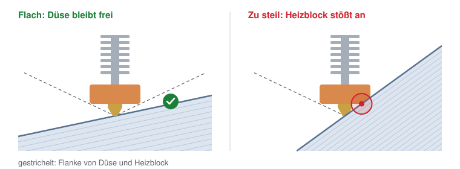

# LSI Lite

[](https://colab.research.google.com/github/gereon1112-web/lsi-lite/blob/main/LSI_lite.ipynb)

LSI Lite erzeugt aus einem FEM-Ergebnis (`.vtu` mit Spannungsfeld) G-Code für einen
handelsüblichen 3-Achs-Drucker. Die Schichten sind nicht eben, sondern folgen der
Zugspannung im Bauteil. Das Werkzeug ist eine reduzierte Fassung des LSI aus der
Diplomarbeit des Autors.

**Status:** Prototyp, erste Bauteile gedruckt.

## Schnellstart

**Im Browser:** über den Colab-Knopf oben (Google-Konto erforderlich). Die Zellen der Reihe
nach ausführen: Eingabe wählen, Einstellungen setzen, rechnen, Ergebnis in 3D prüfen,
G-Code herunterladen.

**Lokal** (Python 3.12 oder neuer):

```
git clone https://github.com/gereon1112-web/lsi-lite.git
cd lsi-lite
python -m venv .venv
.venv/bin/pip install -r requirements.txt          # Linux
.venv\Scripts\pip install -r requirements.txt      # Windows
```

Anschließend `LSI_lite.ipynb` in VS Code mit der Jupyter-Erweiterung öffnen und als
Kernel die Umgebung `.venv` wählen. Eigene Bauteile kommen als `.vtu` in den Ordner
`eingabe/`. Unter Windows ist der Ablauf nicht getestet.

## Einstellungen

Einstellbar sind Düsendurchmesser (Vorgabe 0,4 mm), Füllmuster (konzentrisch, Zickzack
oder entlang der Zugrichtung), Fülldichte, Drucker, Material und Baurichtung.

Maßgeblich ist `neigung_max` (im Code `max_tilt`), die zulässige Schichtneigung
(Vorgabe 20°). Da die Düse
stets senkrecht steht, kollidiert der Heizblock bei zu steilen Schichten mit bereits
gedrucktem Material. Der Wert sollte daher kleiner sein als der Flankenwinkel des
eigenen Druckkopfs.

<p align="center"></p>

## Eingabe und Drucker

Erwartet wird ein Tetraedernetz mit Spannungen an den Knoten, etwa der VTU-Export aus
FreeCAD/CalculiX. Maße in mm; die Unterseite muss in Baurichtung eben sein.

Der G-Code ist für Marlin und Klipper ausgelegt; Bambu-Drucker werden über
[Bambu Connect](https://wiki.bambulab.com/en/software/bambu-connect) angesprochen. Der
Startblock führt keine Bettvermessung durch, die erste Lage ist daher zu überwachen.

## Grenzen

- Keine Stützstrukturen, keine Überhang- und keine Kollisionsprüfung. Die Baurichtung
  ist so zu wählen, dass keine Bereiche frei hängen.

## Dokumentation

Berechnungsablauf und Vereinfachungen gegenüber dem Original: [docs/](docs/README.md).
